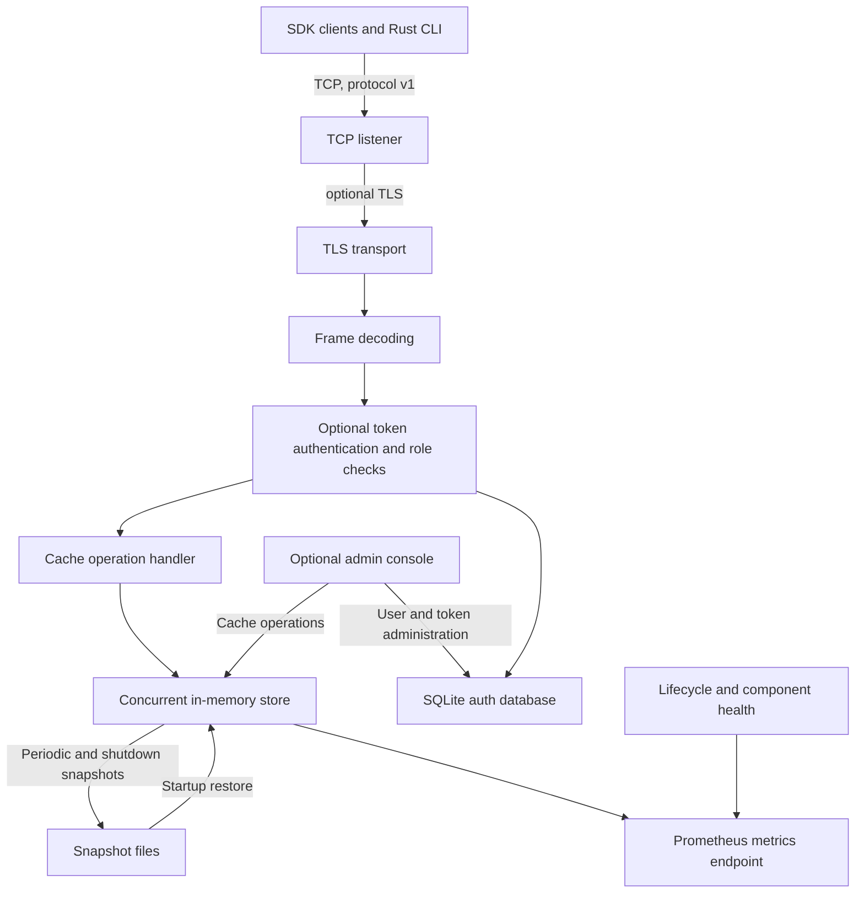
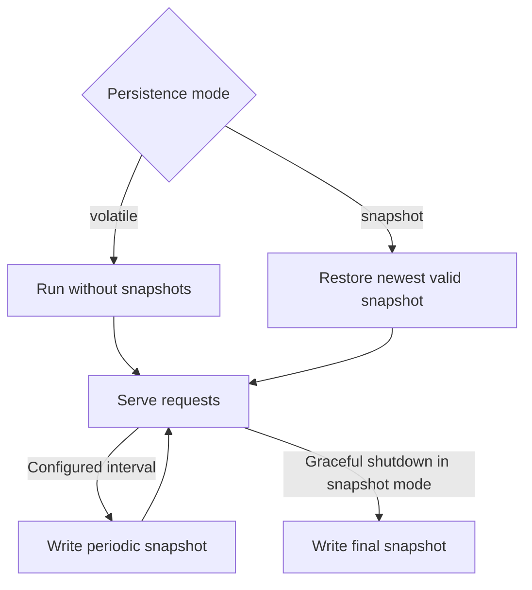

# NebulaCache

NebulaCache is a single-node, in-memory key/value cache exposed over a versioned binary TCP protocol. The repository contains a Rust server and command-line client, Go/Java/JavaScript/Python client SDKs, optional TCP TLS and token authentication, TTL expiration, bounded cache memory with eviction, optional snapshots, Prometheus metrics, health monitoring, and an optional web administration console.

This README describes the system as it exists in this repository. It is not a distributed cache: each server process owns its own data and there is no node discovery, replication, routing, quorum, or automatic failover.

## Contents

- [NebulaCache](#nebulacache)
  - [Contents](#contents)
  - [Architecture and behavior](#architecture-and-behavior)
  - [Repository layout](#repository-layout)
  - [Requirements and checks](#requirements-and-checks)
  - [Run the server](#run-the-server)
  - [Configuration reference](#configuration-reference)
  - [TLS and client authentication](#tls-and-client-authentication)
  - [Admin console](#admin-console)
  - [Snapshots and recovery](#snapshots-and-recovery)
  - [Metrics and health](#metrics-and-health)
  - [Command-line client](#command-line-client)
  - [SDKs](#sdks)
  - [Docker](#docker)
  - [Wire protocol](#wire-protocol)
    - [Request frame](#request-frame)
    - [Response frame](#response-frame)
    - [Opcodes and statuses](#opcodes-and-statuses)
  - [Operational and security boundaries](#operational-and-security-boundaries)

## Architecture and behavior

The system is a single process with a concurrent in-memory store. Requests arrive through TCP, are decoded using protocol v1, and are dispatched to the cache store. HTTP services for Prometheus metrics and the optional admin console run separately from the binary TCP listener.



| Component         | Responsibility                                                                                                                                                                    |
| ----------------- | --------------------------------------------------------------------------------------------------------------------------------------------------------------------------------- |
| `nebula-protocol` | Protocol v1 request/response types, TCP framing, and frame limits.                                                                                                                |
| `nebula-core`     | Concurrent key/value storage, TTL tracking, memory accounting, LRU/LFU/FIFO eviction, and snapshot interfaces.                                                                    |
| `nebula-auth`     | SQLite-backed users, roles, bootstrap credential, API-token hashing/verification, expiry, and revocation.                                                                         |
| `nebula-health`   | Application lifecycle and component health state.                                                                                                                                 |
| `nebula-watchdog` | Background-worker heartbeat monitoring.                                                                                                                                           |
| `nebula-server`   | TCP/TLS listener, optional authentication, HTTP admin console, Prometheus exporter, persistence, and graceful lifecycle management. The package exposes the `nebulad` executable. |
| `nebula-client`   | Rust command-line client for cache operations and local auth database management.                                                                                                 |

Each cache key and value is opaque bytes at the protocol level. TTL is an unsigned integer number of seconds: `0` means no expiration. Entries expire on reads and are also removed by the periodic cleanup worker. Keys are limited to 1,024 bytes and values to 8 MiB. By default, total key-plus-value memory is capped at 64 MiB; LRU eviction is used when needed. Cache capacity and connection counts can be configured.

## Repository layout

- Rust workspace: `./crates/nebula-{protocol,core,auth,health,watchdog,server,client}`
- Go SDK: `./sdk/go`
- Java SDK: `./sdk/java`
- JavaScript SDK: `./sdk/js`
- Python SDK: `./sdk/python`

## Requirements and checks

- Rust stable for the server and CLI (the Docker builder currently uses Rust 1.87).
- Go 1.22 or newer, Java 17 and Maven, Node.js 18 or newer, and Python 3.10 or newer to work with the respective SDKs.
- Docker and Docker Compose are optional.

Run Rust workspace checks from the repository root:

```bash
cargo fmt --all -- --check
cargo test --workspace
cargo build --release --workspace
```

SDK checks are listed in each SDK README. They can also be run from the workspace root with the corresponding directory as the working directory:

- Go: `go test ./...` and `go build ./...`
- Java: `mvn test` and `mvn package`
- JavaScript: `npm test`
- Python: `python -m unittest discover -s tests -v`

## Run the server

The server requires a TOML configuration file. Without an explicit path it reads `./nebulad.toml` from the current working directory; the path is the server's only command-line argument. Make an empty config file to use defaults, or define settings in it. For example, save this as `./nebulad.toml`:

```toml
listen_addr = "127.0.0.1:7001"
log_level = "info"
```

Run the server from the repository root:

```bash
cargo run -p nebula-server -- ./nebulad.toml
```

To use defaults, the file may be empty. The default TCP bind is `0.0.0.0:7001`, which listens on every interface. The default is plaintext and TCP auth is off, so choose a trusted/loopback bind or configure TLS, authentication, and network-level access controls before exposing the listener.

The server rejects unknown TOML fields and invalid combinations at startup. String values in the TOML may contain `${NAME}` or `${NAME:-default}`. Unset variables without a default cause configuration loading to fail. Environment substitutions are converted to the field's expected boolean/numeric type where applicable.

## Configuration reference

All settings and defaults are shown below. Omitted values use these defaults.

```toml
listen_addr = "0.0.0.0:7001"
shutdown_timeout_secs = 30
ttl_cleanup_interval_secs = 3600
log_level = "info"

[admin_console]
enabled = false
listen_addr = "127.0.0.1:7002"
metrics_dashboard = true

[tls]
enabled = false

[security]
authentication = false

[security.auth]
database_path = "nebulad.db"

[persistence]
mode = "volatile"
snapshot_dir = "snapshots"
snapshot_interval_secs = 60
snapshot_retention = 3

[metrics]
enabled = true
listen_addr = "127.0.0.1:7003"

[resource_limits]
max_cache_size_bytes = 67108864
max_connections = 1024
eviction_policy = "lru"
```

The optional admin password and TLS certificate/key paths are unset by default and are intentionally omitted above; set them when enabling password login or TLS. Supported persistence modes are `volatile` and `snapshot`; supported eviction policies are `lru`, `lfu`, and `fifo`.

- `listen_addr`: binary TCP address.
- `shutdown_timeout_secs`: maximum time to wait for workers to stop cleanly.
- `ttl_cleanup_interval_secs`: interval for background cleanup of expired entries; must be positive.
- `log_level`: tracing filter used if `RUST_LOG` is not set.
- `[tls]`: server certificate and private key for the TCP listener. Both paths are required when enabled.
- `[security]`: turns on token authentication. Authentication requires TLS.
- `[security.auth]`: SQLite database path used for users and tokens. Defaults to `nebulad.db` relative to the process working directory.
- `[admin_console]`: enables the HTTP console. If token authentication is off, a non-empty password is required. With token authentication on, users sign in using API tokens instead. The admin listener shares the configured server TLS certificate when TLS is enabled.
- `[persistence]`: optional periodic snapshots and startup recovery. Snapshot mode requires a non-empty directory, positive interval, and positive retention.
- `[metrics]`: enables the plaintext HTTP Prometheus endpoint.
- `[resource_limits]`: byte limit for cache keys and values, maximum concurrent TCP connections, and eviction policy. The protocol frame limits are fixed at 1 KiB keys and 8 MiB values.

## TLS and client authentication

TLS is optional and disabled by default. Configure the server certificate and key as PEM files:

```toml
[tls]
enabled = true
certificate = "/etc/nebula/server-cert.pem"
private_key = "/etc/nebula/server-key.pem"
```

The server does not request TLS client certificates. TLS applies to the binary TCP listener and, when the admin console is enabled, the admin HTTP listener as well. Metrics HTTP remains plaintext. Clients must trust the server certificate and verify its hostname.

Token authentication is separately disabled by default. Enable it with TLS:

```toml
[tls]
enabled = true
certificate = "/etc/nebula/server-cert.pem"
private_key = "/etc/nebula/server-key.pem"

[security]
authentication = true

[security.auth]
database_path = "./data/nebulad.db"
```

When authentication is enabled, every TCP connection must send an `AUTH` request with an API token before any cache command. `readonly` users may GET; `readwrite` users may GET, SET, and DELETE; `admin` users have read/write access and can administer accounts in the console/local auth CLI. PING is permitted after authentication. Tokens are generated randomly, stored as hashes, and may be expired or revoked. The SDKs expose a token option and require TLS with certificate verification when a token is configured. See the SDK readmes for per-language configuration.

On the first authenticated startup, the server creates and prints a **one-time administrator bootstrap credential** to stderr. Use the same auth database file from the local CLI to create the initial admin and one-time API token:

```bash
NEBULA_BOOTSTRAP_TOKEN='credential-printed-by-server' \
  cargo run -p nebula-client -- --auth-db ./data/nebulad.db bootstrap-admin administrator
```

The command prints an API token once. Store it securely. The auth-management commands operate directly on the SQLite database file, rather than through the TCP connection. Continue to use that database path for later administration, and provide the admin token in `NEBULA_TOKEN`:

```bash
NEBULA_TOKEN='admin-api-token' cargo run -p nebula-client -- --auth-db ./data/nebulad.db user create app-reader --role readonly
NEBULA_TOKEN='admin-api-token' cargo run -p nebula-client -- --auth-db ./data/nebulad.db token create app-reader --expires-in 30d
```

Supported local commands include user create/list/show/set-role/disable/enable/delete and token create/list/revoke. Roles are `readonly`, `readwrite`, and `admin`; token expiry accepts a duration such as `30d`, `12h`, `60m`, or `300s`. For authenticated cache requests, configure `NEBULA_TOKEN` and use `--tls-ca` or `NEBULA_TLS_CA` with `nebula-client`.

## Admin console

The web console is disabled by default and listens on `127.0.0.1:7002` when enabled. To use the password login with TLS off the TCP listener may remain plaintext, but the admin console itself is also plaintext in that mode. A password-protected local development configuration looks like this:

```toml
[admin_console]
enabled = true
password = "${NEBULA_ADMIN_PASSWORD}"
listen_addr = "127.0.0.1:7002"
metrics_dashboard = true
```

Start it with the password supplied through the environment:

```bash
NEBULA_ADMIN_PASSWORD='replace-with-a-secret' cargo run -p nebula-server -- ./nebulad.toml
```

Visit `http://127.0.0.1:7002`. When server token authentication is enabled, authenticate with an API token instead of the console password. Console capabilities include:

- Browse cache entries with text search and pagination; the UI renders cache content as text, so use an SDK/CLI for arbitrary binary data.
- Add/update entries with TTL, delete individual entries, and clear the cache.
- View dashboard metrics and component health when `metrics_dashboard` is enabled.
- When token authentication is enabled, create/list/delete users, change roles and enabled state, and create/list/revoke API tokens. These management operations require an admin role. Read-only and read-write roles can browse entries; only read-write/admin roles can alter cache entries.

Sessions expire after eight hours and use HTTP-only, SameSite cookies. Mutating console requests require the session's CSRF token. Keep the console on loopback or behind trusted access controls. Use TLS for the listener when it handles credentials across an untrusted network; the console has no independent TLS certificate settings and reuses the server TLS certificate.

## Snapshots and recovery

Persistence defaults to `volatile`, so a process restart loses all cache entries. In `snapshot` mode the server:

1. Restores the newest valid snapshot during startup, ignoring expired entries.
2. Writes snapshots on the configured interval (default 60 seconds).
3. Keeps the configured number of snapshot files (default three).
4. Writes a final snapshot during graceful shutdown.



Snapshots are checksummed, synchronized to disk, and written to the configured snapshot directory. They are recovery points, not a write-ahead log or replication: changes since the last successful snapshot can be lost on a crash or forced termination. The configured cache byte limit still applies during restoration; entries that cannot fit are not all guaranteed to be restored. Snapshot writes/restores report component health and metrics.

## Metrics and health

Metrics are enabled by default at `http://127.0.0.1:7003/metrics`. The HTTP listener has no built-in authentication or TLS, so keep it on a trusted interface/network. The exporter exposes Prometheus counters, gauges, and histograms for:

- Uptime and lifecycle state.
- Request totals, errors, and duration by operation (`ping`, `set`, `get`, `delete`).
- Active and authenticated connections, auth success/failure, authorization denials, and token revocations.
- Cache entry count and key/value memory accounting.
- Snapshot and recovery counts, failures, durations, last successful snapshot time, and persistence filesystem information when applicable.
- Overall and component health.

The optional admin dashboard presents current health, cache and connection state, request/error rates, latency, persistence status, recent failures, and a bounded history of samples. Disabling the dashboard does not disable the standalone exporter.

## Command-line client

The Rust CLI defaults to `127.0.0.1:7001`; select another TCP address with `--address`/`-a` or `NEBULA_ADDR`:

```bash
cargo run -p nebula-client -- --address 127.0.0.1:7001 ping
cargo run -p nebula-client -- set greeting hello
cargo run -p nebula-client -- set temporary value 30
cargo run -p nebula-client -- get greeting
cargo run -p nebula-client -- delete greeting
```

TLS uses a CA PEM file, supplied with `--tls-ca` or `NEBULA_TLS_CA`. TCP requests accept text arguments in the CLI; use an SDK or the protocol implementation for binary keys/values. Auth database user/token-management commands are described in [TLS and client authentication](#tls-and-client-authentication).

## SDKs

All four SDKs implement the same cache operations: ping, set, get, delete, TTLs, and optional TLS. They return language-appropriate binary data and distinguish missing keys. They also support token authentication over verified TLS.

- Go: [SDK guide](./sdk/go/README.md)
- Java: [SDK guide](./sdk/java/README.md)
- JavaScript: [SDK guide](./sdk/js/README.md)
- Python: [SDK guide](./sdk/python/README.md)

Each SDK README covers installation, API behavior, TLS/auth options, errors, pooling/retry semantics where provided, examples, and tests.

## Docker

The Dockerfile builds the `nebulad` server executable and the Compose file publishes TCP port `7001`. **As currently configured, the image and Compose service do not include or mount the required `nebulad.toml` file**, while the server requires a TOML file at startup. Consequently, `docker compose up --build` as-is does not provide a runnable default server configuration. Supply a configuration file to the container before relying on this workflow; do not assume Compose creates a three-node cluster or configures persistence/authentication. The Dockerfile runs as UID/GID `1000:1000`, so mounted config, snapshot, and auth database paths must be readable/writable as appropriate for that user.

The image exposes port `7001` only. Admin and metrics listeners are not published by the Compose file. The included container setup is for development; production deployments need explicit config, secure credentials and certificates, storage permissions, service/network policy, and monitoring configuration.

## Wire protocol

Protocol version 1 is a framed binary protocol over TCP. TCP is a byte stream, so clients and servers must read the entire fixed header and then each declared payload. All integers are big-endian. The magic bytes are `NEBU`; the current version is `1`.

### Request frame

The fixed request header is 22 bytes, followed by the key bytes and then the value bytes:

| Field        |                  Size | Encoding                                   |
| ------------ | --------------------: | ------------------------------------------ |
| Magic        |               4 bytes | ASCII `NEBU`                               |
| Version      |                1 byte | `u8`, currently `1`                        |
| Opcode       |                1 byte | `u8`, see opcode table                     |
| Key length   |               4 bytes | `u32`, big-endian                          |
| Value length |               4 bytes | `u32`, big-endian                          |
| TTL seconds  |               8 bytes | `u64`, big-endian; `0` means no expiration |
| Key          |   Declared key length | Opaque bytes                               |
| Value        | Declared value length | Opaque bytes                               |

### Response frame

The fixed response header is 10 bytes, followed by the response value:

| Field        |                  Size | Encoding               |
| ------------ | --------------------: | ---------------------- |
| Magic        |               4 bytes | ASCII `NEBU`           |
| Version      |                1 byte | `u8`, currently `1`    |
| Status       |                1 byte | `u8`, see status table |
| Value length |               4 bytes | `u32`, big-endian      |
| Value        | Declared value length | Opaque bytes           |

### Opcodes and statuses

| Opcode   | Value | Behavior                                                                                             |
| -------- | ----: | ---------------------------------------------------------------------------------------------------- |
| `SET`    |     1 | Store the value for a non-empty key, with the request TTL.                                           |
| `GET`    |     2 | Return the stored value or `NOT_FOUND`; key is required and request value must be empty.             |
| `DELETE` |     3 | Delete the key or return `NOT_FOUND`; key is required and request value must be empty.               |
| `PING`   |     4 | Return `OK` with the value `PONG`; request key and value must be empty.                              |
| `AUTH`   |     5 | Authenticate a connection when token authentication is enabled; token is carried in the value field. |

| Status             | Value | Meaning                                                            |
| ------------------ | ----: | ------------------------------------------------------------------ |
| `OK`               |     0 | Request succeeded.                                                 |
| `NOT_FOUND`        |     1 | GET or DELETE key does not exist.                                  |
| `INVALID_ARGUMENT` |     2 | Request arguments are invalid.                                     |
| `INTERNAL_ERROR`   |     3 | Server-side operation failed, including cache capacity exhaustion. |
| `UNAUTHORIZED`     |     4 | Authentication failed or is required.                              |
| `FORBIDDEN`        |     5 | Authenticated role cannot perform the operation.                   |

Keys are limited to 1,024 bytes and values to 8 MiB. `SET` requires a non-empty key. `AUTH` requires an empty key, a non-empty UTF-8 token of at most 1,024 bytes in the value field, and TTL `0`. A successful `AUTH` returns `OK` with `AUTH_RESULT`. When authentication is enabled, the server requires `AUTH` before cache operations on every connection; authentication also requires TLS. The store treats keys and values as opaque bytes, and TTL values are unsigned seconds.

## Operational and security boundaries

- This is a single-node cache. Independent server processes do not synchronize or share cache contents.
- Snapshot persistence is periodic recovery, not continuous durability, replication, or transactional storage.
- TCP client authentication is opt-in. When enabled it requires TLS, and all clients must authenticate on each connection.
- TCP and console TLS share the configured server certificate. Metrics HTTP is plaintext and unauthenticated.
- Default TCP bind is all interfaces. Use trusted networking and explicit security configuration before exposing any listener.
- Under systemd, the server sends readiness notification through `NOTIFY_SOCKET` and supports `WATCHDOG_USEC` heartbeats while the service and its health components are healthy.
- Cache `SET` can fail when an item exceeds the configured cache capacity; eviction policy is applied to make room for new values when possible.
