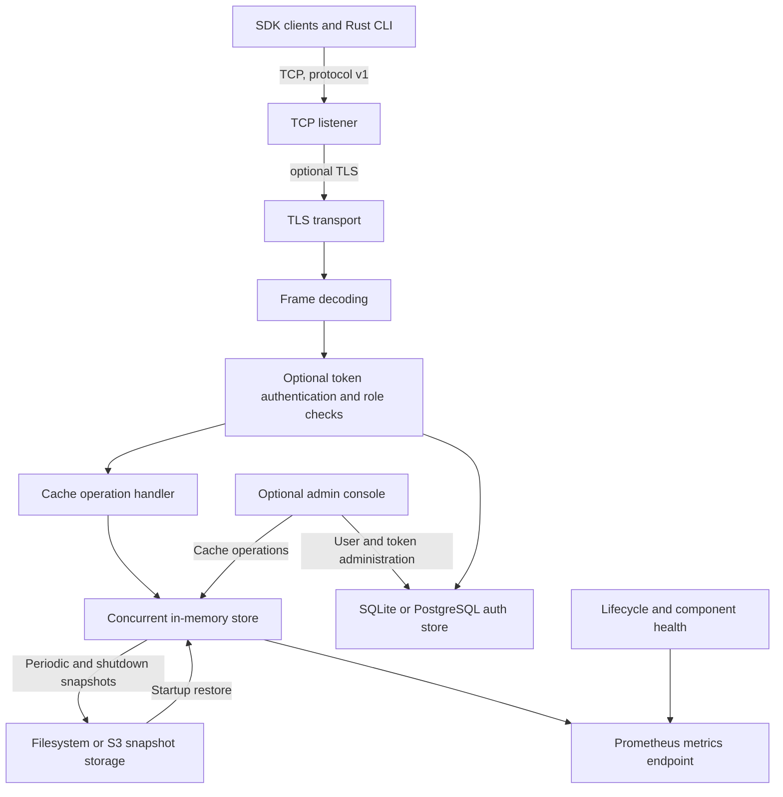
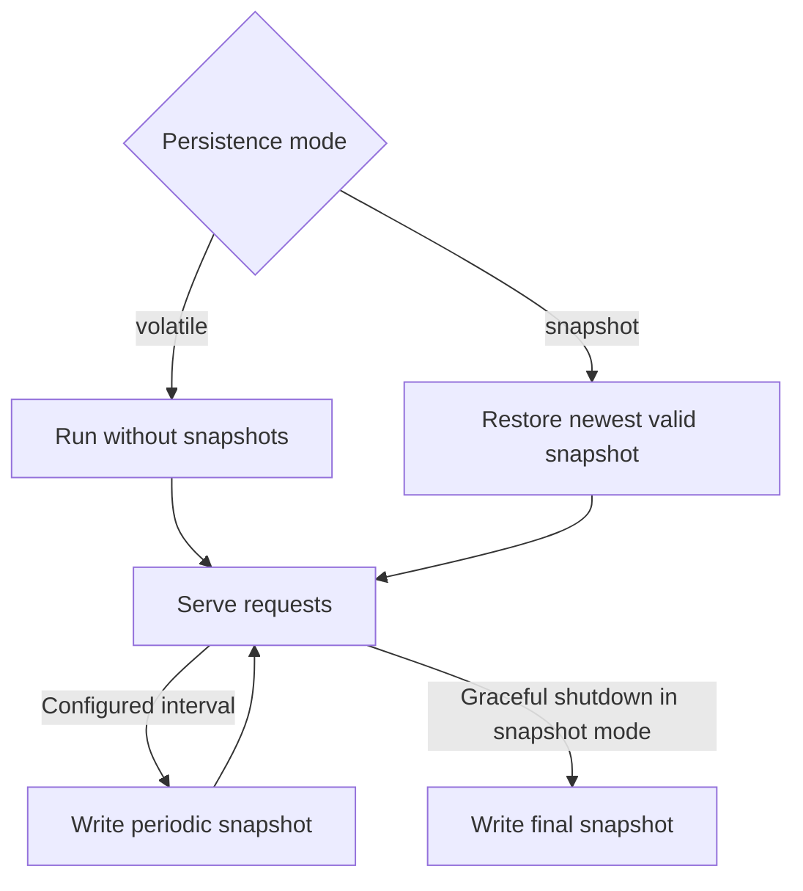

<p align="center">
  
</p>

# NebulaCache

NebulaCache is a single-node, in-memory key/value cache exposed over a versioned binary TCP protocol. The repository contains a Rust server and command-line client, Rust/Go/Java/JavaScript/Python client SDKs, optional TCP TLS and token authentication, TTL expiration, bounded cache memory with eviction, optional snapshots, Prometheus metrics, health monitoring, and an optional web administration console.

This README describes the system as it exists in this repository. It is not a distributed cache: each server process owns its own data and there is no node discovery, replication, routing, quorum, or automatic failover.

## Contents

- [NebulaCache](#nebulacache)
  - [Contents](#contents)
  - [Features](#features)
  - [Architecture and behavior](#architecture-and-behavior)
  - [Repository layout](#repository-layout)
  - [Requirements and checks](#requirements-and-checks)
  - [Run the server](#run-the-server)
  - [Configuration reference](#configuration-reference)
    - [Top-level settings](#top-level-settings)
    - [`[admin]`](#admin)
    - [`[tls]`](#tls)
    - [`[security]` and `[security.auth]`](#security-and-securityauth)
    - [`[persistence]`](#persistence)
    - [`[metrics]`](#metrics)
    - [`[resource_limits]`](#resource_limits)
  - [TLS and client authentication](#tls-and-client-authentication)
  - [Admin console](#admin-console)
  - [Snapshots and recovery](#snapshots-and-recovery)
  - [Metrics and health](#metrics-and-health)
  - [Command-line client](#command-line-client)
  - [SDKs](#sdks)
  - [Docker](#docker)
  - [Wire protocol](#wire-protocol)
    - [Request frame](#request-frame)
    - [Response frame](#response-frame)
    - [Opcodes and statuses](#opcodes-and-statuses)
  - [Operational and security boundaries](#operational-and-security-boundaries)
  - [Performance tests](#performance-tests)
    - [Scenarios](#scenarios)
    - [High-throughput config for 500-VU steady runs](#high-throughput-config-for-500-vu-steady-runs)
    - [Example steady run: 500 VU / 60s](#example-steady-run-500-vu--60s)
    - [Local test](#local-test)
    - [Viewing and interpreting results](#viewing-and-interpreting-results)
      - [Save an HTML report](#save-an-html-report)
    - [Kubernetes test](#kubernetes-test)

## Features

NebulaCache combines a small, explicit server model with practical cache controls and operational tooling:

- **Predictable single-node operation:** one server process owns the cache; there is no hidden clustering or coordination layer.
- **Bounded memory with configurable eviction:** set a cache-wide memory limit and choose LRU, LFU, or FIFO eviction. Entries that still cannot fit are rejected rather than silently exceeding the limit.
- **TTL expiration:** assign per-entry expiration in seconds, with expiration checked on reads and by a background cleanup worker.
- **Compact binary protocol:** a versioned TCP protocol supports opaque values up to 8 MiB, with Rust, Go, Java, JavaScript, and Python clients.
- **Optional TLS and token authentication:** TLS can protect TCP clients; API-token authentication adds role-based read/write access and can be used with or without TLS.
- **Recovery snapshots:** periodically save and restore snapshots using a local filesystem or S3-compatible storage, with retention controls.
- **Built-in operations visibility:** Prometheus metrics, component health reporting, a watchdog, and an optional web console with a metrics dashboard.
- **Async Rust client:** connection pooling, configurable timeouts, verified TLS, token authentication, and bounded retries for GET requests.

## Architecture and behavior

The system is a single process with a concurrent in-memory store. Requests arrive through TCP, are decoded using protocol v1, and are dispatched to the cache store. HTTP services for Prometheus metrics and the optional admin console run separately from the binary TCP listener. User and API-token records are stored in the configured SQLite or PostgreSQL authentication backend; snapshots can use a local filesystem or S3-compatible object storage.



| Component         | Responsibility                                                                                                                                                                    |
| ----------------- | --------------------------------------------------------------------------------------------------------------------------------------------------------------------------------- |
| `nebula-protocol` | Protocol v1 request/response types, TCP framing, and frame limits.                                                                                                                |
| `nebula-core`     | Concurrent key/value storage, TTL tracking, memory accounting, LRU/LFU/FIFO eviction, and snapshot interfaces.                                                                    |
| `nebula-auth`     | SQLite- or PostgreSQL-backed users, roles, bootstrap credential, API-token hashing/verification, expiry, and revocation.                                                          |
| `nebula-health`   | Application lifecycle and component health state.                                                                                                                                 |
| `nebula-watchdog` | Background-worker heartbeat monitoring.                                                                                                                                           |
| `nebula-server`   | TCP/TLS listener, optional authentication, HTTP admin console, Prometheus exporter, persistence, and graceful lifecycle management. The package exposes the `nebulad` executable. |
| `nebula-client`   | Rust command-line client for cache operations and HTTP admin API user/token management.                                                                                           |

Each cache key and value is opaque bytes at the protocol level. TTL is an unsigned integer number of seconds: `0` means no expiration. Entries expire on reads and are also removed by the periodic cleanup worker. Keys are limited to 1,024 bytes and values to 8 MiB. By default, total key-plus-value memory is capped at 64 MiB; LRU eviction is used when needed. Cache capacity and connection counts can be configured.

## Repository layout

- Rust workspace: `./crates/nebula-{protocol,core,auth,health,watchdog,server,client}`
- Rust SDK: `./sdk/rust`
- Go SDK: `./sdk/go`
- Java SDK: `./sdk/java`
- JavaScript SDK: `./sdk/js`
- Python SDK: `./sdk/python`

## Requirements and checks

- Rust stable for the server, CLI, and Rust SDK (the Docker builder uses Rust 1.88).
- Go 1.22 or newer, Java 17 and Maven, Node.js 18 or newer, and Python 3.10 or newer to work with the respective SDKs.
- Docker and Docker Compose are optional.

Run Rust workspace checks from the repository root:

```bash
cargo fmt --all -- --check
cargo test --workspace
cargo build --release --workspace
```

SDK checks are listed in each SDK README. Run the Rust SDK checks from the workspace root; run the other SDK checks from the corresponding SDK directory:

- Rust: `cargo test -p nebulacache` and `cargo build -p nebulacache`
- Go: `go test ./...` and `go build ./...`
- Java: `mvn test` and `mvn package`
- JavaScript: `npm test`
- Python: `python -m unittest discover -s tests -v`

## Run the server

The server requires a TOML configuration file. Without an explicit path it reads `./nebulad.toml` from the current working directory; the path is the server's only command-line argument. Make an empty config file to use defaults, or define settings in it. For example, save this as `./nebulad.toml`:

```toml
listen_addr = "127.0.0.1:17171"
log_level = "info"
```

Run the server from the repository root:

```bash
cargo run -p nebula-server -- ./nebulad.toml
```

To use defaults, the file may be empty. The default TCP bind is `0.0.0.0:17171`, which listens on every interface. The default is plaintext and TCP auth is off, so choose a trusted/loopback bind or configure TLS, authentication, and network-level access controls before exposing the listener.

The server rejects unknown TOML fields and invalid combinations at startup. String values in the TOML may contain `${NAME}` or `${NAME:-default}`. Unset variables without a default cause configuration loading to fail. Environment substitutions are converted to the field's expected boolean/numeric type where applicable.

## Configuration reference

Every configuration field and its default is listed below. Optional TLS paths, the PostgreSQL URL, and optional S3 bucket/region/endpoint/credential values default to unset and are omitted as TOML assignments. All relative paths are resolved from the server process working directory.

```toml
listen_addr = "0.0.0.0:17171"
shutdown_timeout_secs = 30
ttl_cleanup_interval_secs = 3600
log_level = "info"

[admin]
enabled = false
listen_addr = "127.0.0.1:17172"
metrics_dashboard = true

[tls]
enabled = false

[security]
authentication = false

[security.auth]
backend = "sqlite"
database_path = "nebulad.db"

[persistence]
mode = "volatile"
snapshot_backend = "filesystem"
snapshot_dir = "snapshots"
snapshot_s3_prefix = ""
snapshot_interval_secs = 60
snapshot_retention = 3

[metrics]
enabled = true
listen_addr = "127.0.0.1:17173"

[resource_limits]
max_cache_size_bytes = 67108864
max_connections = 1024
eviction_policy = "lru"
```

### Top-level settings

- `listen_addr`: TCP bind address for the binary cache protocol. Defaults to all interfaces on port `17171`.
- `shutdown_timeout_secs`: maximum number of seconds to wait for services and workers to stop cleanly. Defaults to `30`.
- `ttl_cleanup_interval_secs`: interval in seconds between background expired-entry cleanup passes. Must be greater than zero; defaults to `3600`. Expired entries are also removed when accessed.
- `log_level`: tracing filter used unless `RUST_LOG` is set. Defaults to `info`; accepts the tracing-subscriber `EnvFilter` syntax.

### `[admin]`

- `enabled`: starts the HTTP administration console. Defaults to `false`; enabling it requires `security.authentication = true` and the console has no password-login mode.
- `listen_addr`: HTTP bind address for the console. Defaults to `127.0.0.1:17172`.
- `metrics_dashboard`: enables the metrics and health dashboard within the console. Defaults to `true`; this does not control the standalone metrics endpoint.

### `[tls]`

- `enabled`: enables TLS on the binary TCP listener. Defaults to `false`.
- `certificate`: optional path to a PEM server-certificate chain. Required when TLS is enabled.
- `private_key`: optional path to a PEM private key. Required when TLS is enabled.

The server does not request client certificates. Metrics HTTP remains plaintext even when TLS is enabled.

### `[security]` and `[security.auth]`

- `authentication`: requires a valid API-token `AUTH` request on each TCP connection before cache operations. Defaults to `false`; TLS is optional.
- `backend`: authentication database backend, either `sqlite` (default) or `postgres`. The value `postgresql` is also accepted as an alias for `postgres`.
- `database_path`: SQLite database file path, default `nebulad.db` relative to the working directory. Used only with the SQLite backend; must not be empty when TCP authentication or the admin console is enabled.
- `database_url`: PostgreSQL connection string; unset by default and required when the PostgreSQL backend is selected and TCP authentication or the admin console is enabled. Keep credentials out of checked-in config files; environment-variable substitution can supply them.

### `[persistence]`

- `mode`: `volatile` (default) keeps data only in memory; `snapshot` restores and periodically saves recovery snapshots.
- `snapshot_backend`: snapshot storage backend, `filesystem` (default) or `s3`.
- `snapshot_dir`: filesystem snapshot directory, default `snapshots`. Must be non-empty for snapshot mode with the filesystem backend.
- `snapshot_s3_bucket`: S3 bucket name; unset by default and required for snapshot mode with the S3 backend.
- `snapshot_s3_region`: optional S3 region. If omitted, the S3 client uses its normal environment/configuration defaults.
- `snapshot_s3_endpoint`: optional S3-compatible service endpoint. An `http://` endpoint explicitly allows plaintext HTTP; use HTTPS except for trusted local development.
- `snapshot_s3_access_key_id` and `snapshot_s3_secret_access_key`: optional explicit S3 credentials. They must be configured together. If omitted, the S3 client can use its default credential provider chain/environment.
- `snapshot_s3_prefix`: object-key prefix for S3 snapshots; defaults to an empty string. Leading and trailing slashes are removed.
- `snapshot_interval_secs`: interval between snapshots; defaults to `60` and must be positive in snapshot mode.
- `snapshot_retention`: number of recent snapshots to keep; defaults to `3` and must be positive in snapshot mode.

Snapshot settings are validated at startup; backend storage must be configured when snapshot mode is selected. Snapshot recovery is not a write-ahead log or continuous durability mechanism.

### `[metrics]`

- `enabled`: starts the standalone Prometheus HTTP endpoint. Defaults to `true`.
- `listen_addr`: metrics HTTP bind address. Defaults to `127.0.0.1:17173`. The endpoint has no built-in authentication or TLS.

### `[resource_limits]`

- `max_cache_size_bytes`: maximum combined key-and-value memory used by the cache; defaults to `67108864` (64 MiB).
- `max_connections`: maximum concurrent TCP connections; defaults to `1024` and cannot exceed the runtime's supported semaphore limit.
- `eviction_policy`: eviction strategy when the cache needs space; one of `lru` (default), `lfu`, or `fifo`.

The protocol frame limits are fixed at 1 KiB per key and 8 MiB per value. Unknown TOML fields are rejected. String values throughout the config may use `${NAME}` or `${NAME:-default}` environment substitutions; unset variables without a default fail config loading, and substituted boolean/numeric fields are parsed as their target types.

## TLS and client authentication

TLS is optional and disabled by default. Configure the server certificate and key as PEM files:

```toml
[tls]
enabled = true
certificate = "/etc/nebula/server-cert.pem"
private_key = "/etc/nebula/server-key.pem"
```

The server does not request TLS client certificates. TLS applies only to the binary TCP listener. Metrics HTTP remains plaintext. TCP clients must trust the server certificate and verify its hostname.

TCP token authentication is disabled by default. The following example enables TLS as an optional transport-protection layer:

```toml
[tls]
enabled = true
certificate = "/etc/nebula/server-cert.pem"
private_key = "/etc/nebula/server-key.pem"

[security]
authentication = true

[security.auth]
database_path = "./data/nebulad.db"
```

When TCP authentication is enabled, every TCP connection must send an `AUTH` request with an API token before any cache command. `readonly` users may GET; `readwrite` users may GET, SET, and DELETE; `admin` users have read/write access and can administer accounts through the HTTP admin API. PING is permitted after authentication. Tokens are generated randomly, stored as hashes, and may be expired or revoked. TLS is optional for TCP authentication; SDKs expose a token option and can use TLS when configured. See the SDK readmes for per-language configuration.

On the first startup with TCP authentication or the admin console enabled, the server creates and prints a **one-time administrator bootstrap credential** to stderr. Use the CLI against the HTTP admin API to create the initial admin user and one-time API token:

```bash
NEBULA_BOOTSTRAP_TOKEN='credential-printed-by-server' \
  cargo run -p nebula-client -- --admin-address http://127.0.0.1:17172 bootstrap-admin administrator
```

The command prints an API token once. Store it securely. For later administration, provide the admin token through `NEBULA_TOKEN`; user/token commands also use the HTTP admin API:

```bash
NEBULA_TOKEN='admin-api-token' cargo run -p nebula-client -- --admin-address http://127.0.0.1:17172 user create app-reader --role readonly
NEBULA_TOKEN='admin-api-token' cargo run -p nebula-client -- --admin-address http://127.0.0.1:17172 token create app-reader --expires-in 30d
```

The CLI supports user create/list/show/set-role/disable/enable/delete and token create/list/revoke. Roles are `readonly`, `readwrite`, and `admin`; token expiry accepts a duration such as `30d`, `12h`, `60m`, or `300s`. Set `NEBULA_ADMIN_ADDR` instead of repeating `--admin-address`, and configure `NEBULA_TOKEN` for authenticated admin requests. For authenticated cache requests, configure `NEBULA_TOKEN`; `--tls-ca` or `NEBULA_TLS_CA` optionally enables TLS for the TCP client.

## Admin console

The web console is disabled by default and listens on `127.0.0.1:17172` when enabled. The listener serves HTTP only; it does not configure or terminate TLS. It uses token authentication and has no password-login mode. Enabling it also enables token authentication for TCP clients; TCP TLS remains optional. For remote browser and CLI access, place the console behind a TLS-terminating reverse proxy and have the proxy set the session cookie's `Secure` attribute:

```toml
[security]
authentication = true

[admin]
enabled = true
listen_addr = "127.0.0.1:17172"
metrics_dashboard = true
```

After creating an administrator as described above, visit `http://127.0.0.1:17172` locally or use the HTTPS URL exposed by your TLS-terminating proxy. Configure the CLI's `--admin-address` or `NEBULA_ADMIN_ADDR` with that `https://` URL; it uses standard TLS certificate and hostname verification and does not need the proxy's private key or a server-side TLS configuration. Console capabilities include:

- Browse cache entries with text search and pagination; the UI renders cache content as text, so use an SDK/CLI for arbitrary binary data.
- Add/update entries with TTL, delete individual entries, and clear the cache.
- View dashboard metrics and component health when `metrics_dashboard` is enabled.
- Create/list/delete users, change roles and enabled state, and create/list/revoke API tokens. These management operations require an admin role. Read-only and read-write roles can browse entries; only read-write/admin roles can alter cache entries.

Sessions expire after eight hours and use HTTP-only, SameSite cookies. Mutating console requests require the session's CSRF token. The listener and admin REST API use plain HTTP; for remote use, terminate TLS at a trusted reverse proxy and configure the proxy to add the `Secure` cookie attribute. Keep the unencrypted proxy-to-server hop on a trusted network. The CLI uses the scheme in its admin URL as provided; it does not negotiate an HTTP-to-HTTPS upgrade with the API.

## Snapshots and recovery

Persistence defaults to `volatile`, so a process restart loses all cache entries. In `snapshot` mode the server:

1. Restores the newest valid snapshot during startup, ignoring expired entries.
2. Writes snapshots on the configured interval (default 60 seconds).
3. Retains the configured number of recent snapshots in the selected backend (default three).
4. Writes a final snapshot during graceful shutdown.



Snapshots are checksummed and written to the configured filesystem directory or S3-compatible bucket/prefix. They are recovery points, not a write-ahead log or replication: changes since the last successful snapshot can be lost on a crash or forced termination. The configured cache byte limit still applies during restoration; entries that cannot fit are not all guaranteed to be restored. Snapshot writes/restores report component health and metrics.

## Metrics and health

Metrics are enabled by default at `http://127.0.0.1:17173/metrics`. The HTTP listener has no built-in authentication or TLS, so keep it on a trusted interface/network. The exporter exposes Prometheus counters, gauges, and histograms for:

- Uptime and lifecycle state.
- Request totals, errors, and duration by operation (`ping`, `set`, `get`, `delete`).
- Active and authenticated connections, auth success/failure, authorization denials, and token revocations.
- Cache entry count and key/value memory accounting.
- Snapshot and recovery counts, failures, durations, last successful snapshot time, and filesystem storage information when applicable.
- Overall and component health.

The optional admin dashboard presents current health, cache and connection state, request/error rates, latency, persistence status, recent failures, and a bounded history of samples. Disabling the dashboard does not disable the standalone exporter.

## Command-line client

The Rust CLI defaults to `127.0.0.1:17171`; select another TCP address with `--address`/`-a` or `NEBULA_ADDR`:

```bash
cargo run -p nebula-client -- --address 127.0.0.1:17171 ping
cargo run -p nebula-client -- set greeting hello
cargo run -p nebula-client -- set temporary value 30
cargo run -p nebula-client -- get greeting
cargo run -p nebula-client -- delete greeting
```

TCP TLS uses a CA PEM file, supplied with `--tls-ca` or `NEBULA_TLS_CA`. This option applies to the TCP cache connection, not the admin API. TCP requests accept text arguments in the CLI; use an SDK or the protocol implementation for binary keys/values. User and token administration uses the HTTP admin API; when it is exposed through a TLS proxy, set `--admin-address` or `NEBULA_ADMIN_ADDR` to the proxy's `https://` URL.

## SDKs

All five SDKs provide the cache operations appropriate to each language: ping, set, get, delete, TTLs, and optional TLS. They support token authentication with or without TLS and distinguish missing keys. Use TLS when sending tokens over untrusted networks. The Rust SDK is asynchronous and additionally provides connection pooling, configurable timeouts, and bounded GET retries.

- Rust: [SDK guide](./sdk/rust/README.md)
- Go: [SDK guide](./sdk/go/README.md)
- Java: [SDK guide](./sdk/java/README.md)
- JavaScript: [SDK guide](./sdk/js/README.md)
- Python: [SDK guide](./sdk/python/README.md)

Each SDK README covers installation, API behavior, TLS/auth options, errors, pooling/retry semantics where provided, examples, and tests.

## Docker

The Dockerfile builds the `nebulad` server executable and the Compose file publishes TCP port `17171`. **As currently configured, the image and Compose service do not include or mount the required `nebulad.toml` file**, while the server requires a TOML file at startup. Consequently, `docker compose up --build` as-is does not provide a runnable default server configuration. Supply a configuration file to the container before relying on this workflow; do not assume Compose creates a three-node cluster or configures persistence/authentication. The Dockerfile runs as UID/GID `1000:1000`, so mounted config, snapshot, and auth database paths must be readable/writable as appropriate for that user.

The image exposes port `17171` only. Admin and metrics listeners are not published by the Compose file. The included container setup is for development; production deployments need explicit config, secure credentials and certificates, storage permissions, service/network policy, and monitoring configuration.

## Wire protocol

Protocol version 1 is a framed binary protocol over TCP. TCP is a byte stream, so clients and servers must read the entire fixed header and then each declared payload. All integers are big-endian. The magic bytes are `NEBU`; the current version is `1`.

### Request frame

The fixed request header is 22 bytes, followed by the key bytes and then the value bytes:

| Field        |                  Size | Encoding                                   |
| ------------ | --------------------: | ------------------------------------------ |
| Magic        |               4 bytes | ASCII `NEBU`                               |
| Version      |                1 byte | `u8`, currently `1`                        |
| Opcode       |                1 byte | `u8`, see opcode table                     |
| Key length   |               4 bytes | `u32`, big-endian                          |
| Value length |               4 bytes | `u32`, big-endian                          |
| TTL seconds  |               8 bytes | `u64`, big-endian; `0` means no expiration |
| Key          |   Declared key length | Opaque bytes                               |
| Value        | Declared value length | Opaque bytes                               |

### Response frame

The fixed response header is 10 bytes, followed by the response value:

| Field        |                  Size | Encoding               |
| ------------ | --------------------: | ---------------------- |
| Magic        |               4 bytes | ASCII `NEBU`           |
| Version      |                1 byte | `u8`, currently `1`    |
| Status       |                1 byte | `u8`, see status table |
| Value length |               4 bytes | `u32`, big-endian      |
| Value        | Declared value length | Opaque bytes           |

### Opcodes and statuses

| Opcode   | Value | Behavior                                                                                             |
| -------- | ----: | ---------------------------------------------------------------------------------------------------- |
| `SET`    |     1 | Store the value for a non-empty key, with the request TTL.                                           |
| `GET`    |     2 | Return the stored value or `NOT_FOUND`; key is required and request value must be empty.             |
| `DELETE` |     3 | Delete the key or return `NOT_FOUND`; key is required and request value must be empty.               |
| `PING`   |     4 | Return `OK` with the value `PONG`; request key and value must be empty.                              |
| `AUTH`   |     5 | Authenticate a connection when token authentication is enabled; token is carried in the value field. |

| Status             | Value | Meaning                                                            |
| ------------------ | ----: | ------------------------------------------------------------------ |
| `OK`               |     0 | Request succeeded.                                                 |
| `NOT_FOUND`        |     1 | GET or DELETE key does not exist.                                  |
| `INVALID_ARGUMENT` |     2 | Request arguments are invalid.                                     |
| `INTERNAL_ERROR`   |     3 | Server-side operation failed, including cache capacity exhaustion. |
| `UNAUTHORIZED`     |     4 | Authentication failed or is required.                              |
| `FORBIDDEN`        |     5 | Authenticated role cannot perform the operation.                   |

Keys are limited to 1,024 bytes and values to 8 MiB. `SET` requires a non-empty key. `AUTH` requires an empty key, a non-empty UTF-8 token of at most 1,024 bytes in the value field, and TTL `0`. A successful `AUTH` returns `OK` with `AUTH_RESULT`. When authentication is enabled, the server requires `AUTH` before cache operations on every connection. TLS is optional; without it, TCP traffic and authentication tokens are sent in plaintext. The store treats keys and values as opaque bytes, and TTL values are unsigned seconds.

## Operational and security boundaries

- This is a single-node cache. Independent server processes do not synchronize or share cache contents.
- Snapshot persistence is periodic recovery, not continuous durability, replication, or transactional storage.
- TCP client authentication is opt-in. When enabled, all clients must authenticate on each connection; TLS is optional and plaintext connections expose tokens to network observers.
- The admin console uses HTTP and token authentication; metrics HTTP is plaintext and unauthenticated.
- Default TCP bind is all interfaces. Use trusted networking and explicit security configuration before exposing any listener.
- Under systemd, the server sends readiness notification through `NOTIFY_SOCKET` and supports `WATCHDOG_USEC` heartbeats while the service and its health components are healthy.
- Cache `SET` can fail when an item exceeds the configured cache capacity; eviction policy is applied to make room for new values when possible.

## Performance tests

NebulaCache is a single-node in-memory cache with a binary TCP protocol, so this harness builds k6 with Grafana's `xk6-tcp` extension. The k6 `setup()` phase preloads the keyspace before measurement. Each VU then opens one TCP connection per iteration and issues `BATCH_SIZE` sequential operations before closing it. Prefill requests are excluded from the operation metrics. GET and DELETE misses are expected protocol responses; unexpected statuses and protocol/transport errors are reported as failed checks. Latency measures the request/response round trip and excludes connection establishment; throughput includes the amortized connection setup/teardown cost. Metrics include overall and per-operation latency, request counts, and error rates.

The cache is not distributed. Keep the Kubernetes Deployment at one replica; additional replicas would be independent caches and would not represent a clustered deployment. Results depend on CPU/memory limits, cluster node, and network path. The current store protects cache accounting with a mutex, so the worker-count comparisons can help identify contention.

### Scenarios

| `SCENARIO`    | Operation mix                            | Focus                              |
| ------------- | ---------------------------------------- | ---------------------------------- |
| `steady`      | 70% GET, 30% SET                         | Baseline mix                       |
| `read-heavy`  | 95% GET, 5% SET                          | Read latency and throughput        |
| `write-heavy` | 20% GET, 80% SET                         | Mutation throughput and contention |
| `churn`       | 34% GET, 33% SET, 33% DELETE             | Entry turnover and miss rate       |
| `hot-key`     | 95% GET, 5% SET; 90% target the same key | Hot-key contention                 |
| `ttl`         | 70% GET, 30% SET with 2-second TTL       | Expiration and expected misses     |
| `large-value` | 50% GET, 50% SET                         | Payload and memory-copy cost       |
| `ping`        | PING only                                | Protocol/network baseline          |

k6 reports operation latency percentiles and rate, errors, checks, and TCP transport metrics. Configure `KEYSPACE` to fit under the 256 MiB cache budget. `large-value` defaults to 128 keys of 1 MiB each; the other scenarios default to 10,000 keys with 128-byte values. `VALUE_SIZE` overrides the payload size in bytes, and `BATCH_SIZE` defaults to 25 operations per connection. Keep `BATCH_SIZE` fixed when comparing scenarios.

### High-throughput config for 500-VU steady runs

For a high-concurrency local baseline, use a tuned server config and raise the OS file-descriptor limit before starting Nebula:

```bash
ulimit -n 65535
```

```toml
listen_addr = "0.0.0.0:17171"
log_level = "warn"
shutdown_timeout_secs = 30
ttl_cleanup_interval_secs = 300

[metrics]
enabled = true
listen_addr = "0.0.0.0:17173"

[resource_limits]
eviction_policy = "lru"
max_cache_size_bytes = 268435456
max_connections = 65535

[persistence]
mode = "volatile"

[security]
authentication = false
```

This keeps the cache hot, disables unnecessary persistence/auth overhead, and leaves room for a burst of TCP connections during heavy load tests.

### Example steady run: 500 VU / 60s

On a local Linux workstation with the tuned config above, a steady-state benchmark using `SCENARIO=steady`, `VUS=500`, `DURATION=60s`, `KEYSPACE=10000`, `VALUE_SIZE=128`, and `BATCH_SIZE=25` produced:

- `Operations: 603720 (9534.3 ops/s)`
- `Operation error rate: 0%`
- `Checks: 603720 / 603720 passed`
- `p95 latency: 121 ms`
- `p90 latency: 100 ms`
- `avg latency: 47.7 ms`

This is a local baseline only; run the same test on your target machine when comparing hardware, kernel, or network differences. The point is that Nebula sustains a high non-error throughput with very low steady-state error rates while using a simple in-memory, single-node deployment.

### Local test

Install Docker, build the server and k6 runner images from the repository root, then start the server with the benchmark config:

```sh
docker build -t nebulacache:dev .
docker build -f perf/Dockerfile -t nebulacache-k6:dev .
docker run --rm --name nebula-perf \
  -p 17171:17171 -p 17173:17173 \
  -v "$PWD/k8s/perf/nebulad.toml:/etc/nebulacache/nebulad.toml:ro" \
  -e NEBULA_LISTEN_ADDR=0.0.0.0:17171 \
  -e NEBULA_METRICS_ADDR=0.0.0.0:17173 \
  nebulacache:dev /etc/nebulacache/nebulad.toml
```

In another terminal, run k6 with host networking so its TCP VUs can reach the server:

```sh
docker run --rm --network host nebulacache-k6:dev run \
  -e TARGET=127.0.0.1 -e SCENARIO=steady -e VUS=16 -e DURATION=30s \
  -e KEYSPACE=10000 -e VALUE_SIZE=128 -e BATCH_SIZE=25 /scripts/cache.js
```

Change `SCENARIO` to test another profile. Use the `--network host` form on Linux; on Docker Desktop, remove `--network host`, publish the server ports as above, and use `-e TARGET=host.docker.internal`.

### Viewing and interpreting results

The k6 summary is printed to the terminal when a run ends. To keep a text copy:

```sh
mkdir -p perf-results
set -o pipefail
docker run --rm --network host nebulacache-k6:dev run \
  -e TARGET=127.0.0.1 -e SCENARIO=steady -e VUS=16 -e DURATION=30s \
  -e KEYSPACE=10000 -e VALUE_SIZE=128 -e BATCH_SIZE=25 /scripts/cache.js \
  | tee perf-results/steady.txt
```

The key metrics are:

| Metric                                    | What to look at                                                                                                |
| ----------------------------------------- | -------------------------------------------------------------------------------------------------------------- |
| `nebula_operations_total`                 | Total measured operations and aggregate operations/second.                                                     |
| `nebula_<operation>_latency`              | Per-operation average and p90/p95/p99 latency; p95/p99 show tail latency.                                      |
| `nebula_<operation>_errors` and k6 checks | Unexpected protocol or transport failures. These should remain zero / pass.                                    |
| `nebula_get_misses`                       | Expected missing-key GETs, especially relevant to TTL and churn scenarios.                                     |
| `tcp_socket_duration`                     | Duration of a connection including the batch; compare with operation latency, which excludes connection setup. |

For comparisons, keep scenario, VUs, duration, keyspace, value size, and batch size constant; change one factor at a time. Avoid running overlapping tests against the same server. Record server CPU and memory as well, since client-reported throughput alone does not identify the bottleneck.

#### Save an HTML report

The k6 script writes a self-contained HTML report with summary cards, thresholds, checks, and all metric statistics. Mount a local output directory and set `REPORT_PATH`:

```sh
mkdir -p perf-results
docker run --rm --network host --user "$(id -u):$(id -g)" \
  -v "$PWD/perf-results:/results" nebulacache-k6:dev run \
  -e TARGET=127.0.0.1 -e SCENARIO=steady -e VUS=16 -e DURATION=30s \
  -e KEYSPACE=10000 -e VALUE_SIZE=128 -e BATCH_SIZE=25 \
  -e REPORT_PATH=/results/steady.html /scripts/cache.js
```

Open the report with `xdg-open perf-results/steady.html` (or your browser). Use a different filename for each run to retain comparisons. The report is local to the k6 runner; for Kubernetes Jobs, copy it out of the pod before deleting the Job.

### Kubernetes test

Build both images and load/push them so the cluster can pull them. For a local kind cluster:

```sh
docker build -t nebulacache:dev .
docker build -f perf/Dockerfile -t nebulacache-k6:dev .
kind load docker-image nebulacache:dev nebulacache-k6:dev
kubectl apply -f k8s/perf/nebula.yaml
kubectl -n nebula-perf rollout status deployment/nebula-cache-perf
```

Minikube users can substitute `minikube image load`; remote-cluster users should push both images and update their image names in the manifests. Run the included smoke Job:

```sh
kubectl apply -f k8s/perf/k6-smoke.yaml
kubectl -n nebula-perf logs -f job/nebula-k6-smoke
```

The log stream shows the k6 text summary. Save it locally with:

```sh
mkdir -p perf-results
kubectl -n nebula-perf logs job/nebula-k6-smoke | tee perf-results/k8s-smoke.txt
```

The smoke Job also writes an HTML report inside its pod. After the Job completes, copy it out before deleting the pod or Job:

```sh
pod=$(kubectl -n nebula-perf get pods -l job-name=nebula-k6-smoke -o jsonpath='{.items[0].metadata.name}')
kubectl -n nebula-perf cp "$pod":/tmp/nebula-k6-smoke.html perf-results/k8s-smoke.html
xdg-open perf-results/k8s-smoke.html
```

For other scenarios or load settings, create a Job with a unique name and desired k6 environment. Example:

```sh
kubectl -n nebula-perf create job nebula-k6-write \
  --image=nebulacache-k6:dev --image-pull-policy=IfNotPresent -- \
  run -e SCENARIO=write-heavy -e VUS=32 -e DURATION=60s \
  -e KEYSPACE=10000 -e VALUE_SIZE=128 -e BATCH_SIZE=25 \
  -e REPORT_PATH=/tmp/nebula-k6-write.html /scripts/cache.js
kubectl -n nebula-perf logs -f job/nebula-k6-write
```

Available scenario names are shown above. Repeat with `read-heavy`, `hot-key`, `churn`, `ttl`, `large-value`, and `ping`. Do not run competing benchmark Jobs against the same target when comparing results. Compare a baseline, then increase `VUS` (for example 1, 8, 32, 64) while keeping the other parameters fixed. Also compare p95/p99 latency, errors, CPU, and memory.

Metrics are available through the service on port `17173`:

```sh
kubectl -n nebula-perf port-forward service/nebula-cache-perf 17173:17173
curl -s http://127.0.0.1:17173/metrics
kubectl -n nebula-perf top pod -l app=nebula-cache-perf
```

The metrics endpoint is unauthenticated; keep it on a trusted network. The manifests use volatile storage and disable auth/TLS/snapshots to isolate the cache baseline. Test those features separately when you want to measure their overhead.

To remove the benchmark namespace and all its resources:

```sh
kubectl delete namespace nebula-perf
```
